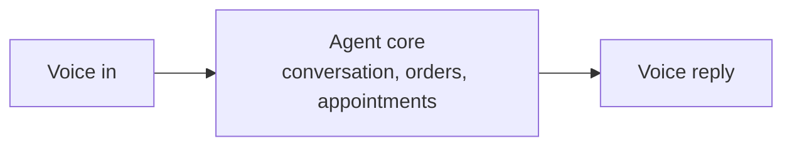

# Voice Agent

A self-hosted voice AI that talks with your customers, takes orders and books appointments.

<Callout type="info">
  The Voice Agent is in development. It comes after the Miralas core is finished. Follow progress on
  [Miransas News](/news/voice-agent).
</Callout>

---

## What it does

| Capability | What it means |
| --- | --- |
| Natural conversation | Talks in a normal, flowing way instead of reading fixed menus |
| Voice input | Understands spoken requests, not only typed text |
| Orders | Collects what a customer wants and keeps the order straight |
| Appointments | Books, checks and organizes appointment times |
| Memory within a conversation | Remembers what was said earlier in the same session |

The goal is simple logic, done reliably. We would rather build an agent that does a few things well than one that promises everything.

---

## Where it fits

The agent is made for businesses and for homes: any place where someone needs to ask for something by voice, and a clear answer or action should follow, such as placing an order or booking a time.

---

## Languages

Turkish and Uzbek come first. English and Russian are supported too.

---

## How it works

This is a simplified view. Inside, the agent keeps a session for each conversation and streams audio in both directions.

---

## Why self-hosted

You run the agent on your own infrastructure. That means conversations stay with you, and you decide where the data lives.

| Part | Technology |
| --- | --- |
| API | FastAPI |
| Language model | LLaMA 3.1 8B running on Ollama |
| Session core | Rust |
| Voice streaming | Binary WebSocket |

---

## Status

| Stage | State |
| --- | --- |
| Core conversation and sessions | Working in development |
| Voice streaming over WebSocket | In progress |
| Public release | Not scheduled yet |

Want to know when it is ready? Follow [Miransas News](/news) or the [RSS feed](/news/rss.xml), or [get in touch](/contact).