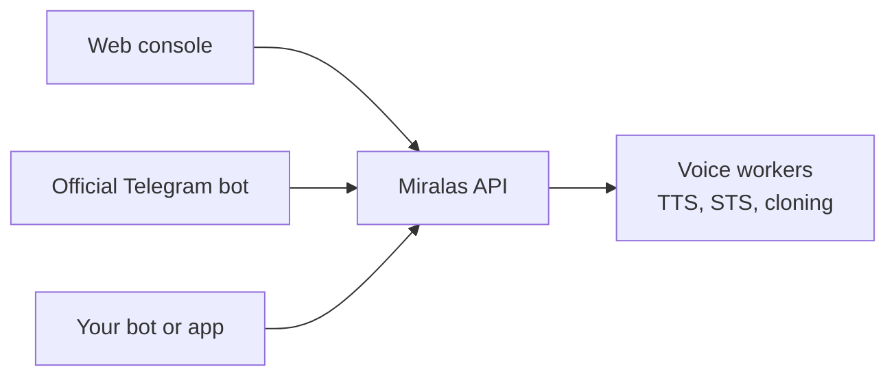

# Developers

Miransas is a small team that builds developer tools, voice AI and the infrastructure under them. This page is honest about what you can use today and what is still on the way.

---

## What you can use today

| Tool | What it is | Where |
| --- | --- | --- |
| Binboi | A self-hosted ngrok alternative with a CLI and a dashboard | [binboi.com](https://binboi.com) |
| VS Code Uzbek Language Pack | The VS Code interface translated into Uzbek | VS Code Marketplace |
| Chatterbox integration notes | How we use the Chatterbox TTS family in our voice layer | [Models](/models) |

---

## Miralas for developers

Miralas is our native Uzbek voice AI platform. We are designing it as a **platform with several kinds of clients**, not only a website:

Each client gets its own token, its own rate limits and its own scope. Our own bot is internal. Third-party bots will use a public API with per-token limits.

<Callout type="warning">
  The public Miralas API is not open yet. A developer plan is planned, and we will announce it on
  [Miransas News](/news) first. There is no sign-up for API access today.
</Callout>

---

## How we build

| Layer | What we use |
| --- | --- |
| Core services | Rust (Axum, Tokio) |
| Frontends | Next.js |
| Model workers | Python, connected to the Rust core over gRPC |
| Database | PostgreSQL |

We pick tools that stay reliable for years and need little maintenance. For core layers, we prefer a language that is slower to write in but does not need constant upkeep.

---

## Security and responsible disclosure

If you find a vulnerability in anything we run, please tell us through the [contact page](/contact) and give us a chance to fix it before you publish details. We take reports seriously and we will answer them.

---

## Stay in the loop

1. Follow [Miransas News](/news) or subscribe to the [RSS feed](/news/rss.xml).
2. Questions about a product? Visit [Support](/support).
3. Want to build something with us or on top of us? [Get in touch](/contact).