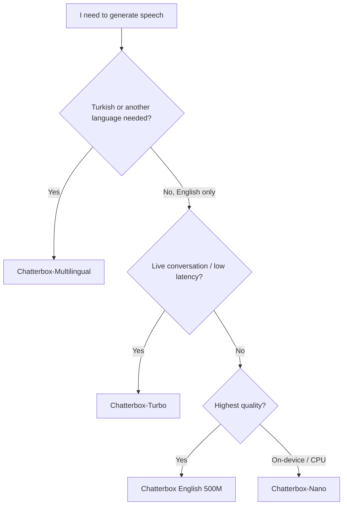
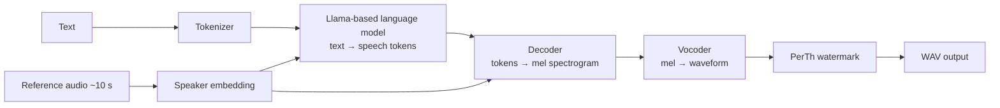
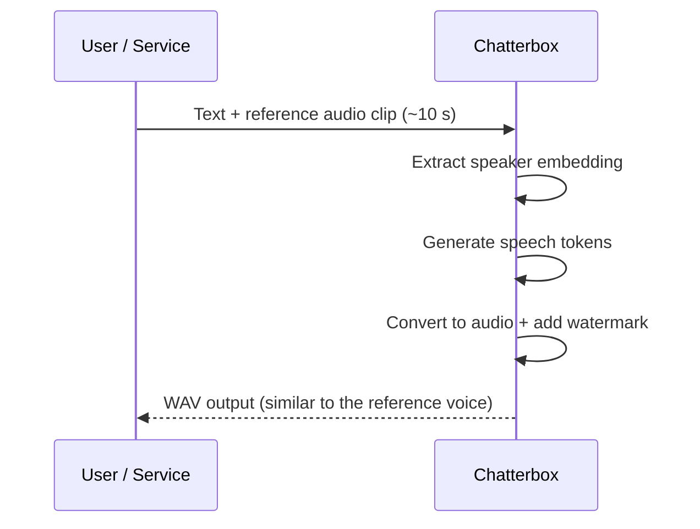

<Callout type="info">
  The [upstream repository](https://github.com/resemble-ai/chatterbox) now describes Chatterbox as retired research. Its code remains available under MIT. These notes describe the model family, not an upstream support commitment or a released Miransas API.
</Callout>

## Chatterbox at a Glance

| Feature | Value |
| --- | --- |
| Developer | Resemble AI |
| License | MIT (commercial use allowed) |
| Task | Text-to-Speech + Voice Conversion |
| Voice cloning | Zero-shot, a reference clip of about 10 seconds is enough |
| Emotion control | `exaggeration` and `cfg_weight` parameters |
| Watermarking | PerTh (Perceptual Threshold) neural watermark on every output |
| Deployment | Self-hosted, GPU recommended |
| Python | A Python 3.11 setup is recommended |

---

## Why Chatterbox?

1. **Open source and MIT licensed.** The model can be run on operator-controlled infrastructure. A self-hosted deployment can keep processing within the operator’s chosen environment.
2. **No per-usage fees.** The cost is the cost of the GPU/server. There is no per-minute or per-character billing.
3. **Zero-shot cloning.** There is no need to train a model for every new voice. A short reference recording is enough.
4. **Emotion control.** The same text can be read calmly, with emphasis, or dramatically.
5. **A low-latency variant (Turbo).** Designed for live, conversational voice agents.
6. **A multilingual variant.** Supports 23 languages, including Turkish.
7. **Responsible AI.** Every generated audio file is marked with an imperceptible watermark.

---

## The Model Family

Chatterbox is not a single model. It is a **family**, split by use case.

| Variant | Parameters | Languages | Key feature | Best for |
| --- | --- | --- | --- | --- |
| **Chatterbox (English)** | ~500M | English | CFG and emotion (exaggeration) control | High-quality English narration |
| **Chatterbox-Turbo** | ~350M | English | Low latency, lower VRAM, paralinguistic tags | Real-time voice agents |
| **Chatterbox-Multilingual** | ~500M | 23+ | Multilingual zero-shot cloning | Localization, global products |
| **Chatterbox-Nano** | ~110M | English | Same architecture as Turbo, built for on-device/CPU | Resource-constrained environments |

<Callout type="info">
  The latest release of Chatterbox Multilingual is listed as **V3** in the official repository. When
  installing, check the package version and checkpoint selection in the upstream example.
</Callout>

### Which variant should we pick?



---

## How It Works

Chatterbox does not turn text directly into a waveform. It splits the job into **stages**. First, a **sequence of speech tokens** is generated from the text. Then those tokens are converted into audio.



### Stages

| # | Stage | What it does |
| --- | --- | --- |
| 1 | **Tokenizer** | Splits the text into pieces the model understands |
| 2 | **Speaker embedding** | Extracts the voice's "fingerprint" (timbre, pitch, style) from the reference recording |
| 3 | **Language model (Llama-based)** | Generates speech tokens from the text and the voice identity |
| 4 | **Decoder** | Converts tokens into a mel spectrogram |
| 5 | **Vocoder** | Produces an audible waveform from the mel spectrogram |
| 6 | **PerTh watermark** | Embeds an imperceptible neural watermark into the output |

The practical result of this design: the **language model determines content and rhythm**, while the **speaker embedding determines identity**. That is why we can read the same text in different voices, or read different texts in the same voice.

---

## Voice Cloning

Cloning a voice with Chatterbox requires no model training. You provide a reference audio clip and the model captures the characteristics of that voice.



### For a good reference clip

1. Use a single speaker, with no music or other voices in the background.
2. Use a clean, noise-free recording without echo.
3. Aim for roughly 10 seconds of clear, natural speech.
4. Match the language of the reference to the target language as closely as possible.
5. Only clone voices you **have the right to use** (your own recording or written permission).

---

## Emotion and Style Control

The English and multilingual models have two main parameters:

| Parameter | What it does | Practical use |
| --- | --- | --- |
| `exaggeration` | Increases or decreases emotional emphasis | Low: calm, newsreader style. High: dramatic, excited |
| `cfg_weight` | Balances adherence to the reference voice against pacing | Lower values can give slower, more measured speech |

High `exaggeration` tends to speed up speech. Lowering `cfg_weight` is a good starting point to balance this. Pick starting values based on the tips in the official repository, then test them with your own voices.

### Paralinguistic tags (Turbo)

The Turbo model can add natural non-speech sounds through tags written inside the text:

```text
That was honestly hilarious [laugh] I can't believe it!
```

| Tag | Effect |
| --- | --- |
| `[laugh]` | Laughter |
| `[chuckle]` | Soft chuckle |

<Callout type="warning">
  Paralinguistic tags are specific to the **Turbo** (and Nano) variants. Do not use the same tags with
  the Multilingual model.
</Callout>

---

## Language Support

Chatterbox-Multilingual supports 23 languages. Turkish is one of them.

| Region | Languages |
| --- | --- |
| Europe | English, German, French, Spanish, Italian, Portuguese, Dutch, Polish, Danish, Swedish, Norwegian, Finnish, Greek |
| Middle East and South Asia | Turkish, Arabic, Hebrew, Hindi |
| East Asia | Chinese, Japanese, Korean, Malay |
| Other | Russian, Swahili |

> The language list may grow between versions. Check the [upstream language list](https://github.com/resemble-ai/chatterbox#supported-languages) for the current list.

---

## Usage Example

Installation:

```bash
conda create -yn chatterbox python=3.11
conda activate chatterbox

git clone https://github.com/resemble-ai/chatterbox.git
cd chatterbox
pip install -e .
```

Generating speech with Turbo:

```python
import torchaudio as ta
from chatterbox.tts_turbo import ChatterboxTurboTTS

model = ChatterboxTurboTTS.from_pretrained(device="cuda")

text = "Hi, I'm the Miransas voice assistant. [chuckle] How can I help you today?"
wav = model.generate(text, audio_prompt_path="sample_reference_10s.wav")

ta.save("output.wav", wav, model.sr)
```

> Turbo is English-focused. For Turkish text, use the **Multilingual** variant.

---

## Safety and Responsible Use

Voice cloning is a powerful technology and carries a risk of misuse. Chatterbox addresses this on two levels.

| Layer | Description |
| --- | --- |
| **PerTh watermark** | Every generated audio file receives an imperceptible neural watermark. It is designed to survive MP3 compression and audio editing. The watermark can later be extracted and checked to verify that the audio is AI-generated. |
| **Usage policy** | Cloning someone's voice without permission, impersonating a person, or producing misleading content is prohibited and unethical. |

### Miransas principles

1. We only work with **authorized** voices (authorized speakers or recordings with written permission).
2. Generated voices are used with clear disclosure that they are synthetic, and never to deceive anyone.
3. Data handling depends on the actual deployment and the applicable product terms.
4. Our [current legal policies](https://privacy.miransas.com/legal/privacy) describe the published terms.

---

## Quality and Comparison

Evaluate voice quality with a representative test set. This page does not publish Miransas benchmarks or make a production latency guarantee.

### Key differences between Chatterbox and paid TTS APIs

| Topic | Chatterbox (self-hosted) | Paid cloud TTS APIs |
| --- | --- | --- |
| Cost model | Server/GPU cost | Per-character or per-minute fees |
| Data privacy | Data handling is controlled by the operator | Data goes to a third party |
| Customization | Full control over code and model | Limited to the provider's settings |
| Setup and maintenance | The operator manages it | The provider manages it |
| Scaling | Depends on GPU capacity | The provider scales for you |
| License | MIT | Provider terms |

---

## Limitations

Let's be honest, Chatterbox is not perfect:

1. **GPU requirement.** A GPU is needed for good speed. The Nano variant exists for lightweight environments, but there may be quality and feature trade-offs.
2. **Uneven language quality.** Quality is not equal across all 23 languages. Listen with your own test set for each language before going to production.
3. **Sensitive to reference quality.** A poor, noisy reference clip produces a poor clone.
4. **Long texts.** Splitting very long texts into sentences or paragraphs is usually more stable.
5. **Tag support.** Tags like `[laugh]` only work in the Turbo and Nano family.

---

## FAQ

<details>
<summary>Is Chatterbox free?</summary>

The model is MIT licensed and can be downloaded and used for free. The cost is the cost of the hardware (GPU/server) you run it on.

</details>

<details>
<summary>Can I clone my own voice?</summary>

Yes. A clean recording of about 10 seconds is enough. Only use your own voice or voices you have permission to use.

</details>

<details>
<summary>Does it support Turkish?</summary>

Yes, Chatterbox-Multilingual supports Turkish. Do not use the English-focused Turbo and English variants for Turkish.

</details>

<details>
<summary>Is generated audio marked as synthetic?</summary>

Yes. Every output carries a PerTh neural watermark, which can later be extracted and verified.

</details>

<details>
<summary>Can it be used in real time?</summary>

The Turbo variant is designed for this: low latency and low VRAM requirements. Actual latency depends on your hardware and setup.

</details>

---

## Resources

| Resource | Link |
| --- | --- |
| Official GitHub repository | [github.com/resemble-ai/chatterbox](https://github.com/resemble-ai/chatterbox) |
| Developer | [resemble.ai](https://www.resemble.ai) |
| Hugging Face model pages | `ResembleAI` organization |

*Sources checked on 9 November 2026: the [official repository](https://github.com/resemble-ai/chatterbox) and [Turbo model card](https://huggingface.co/ResembleAI/chatterbox-turbo). Their upstream information is not a Miransas product-support contract.*