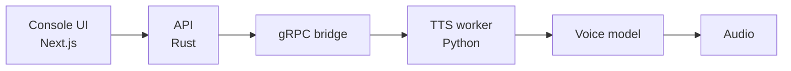

Miralas is our voice AI platform in development for streamers and content creators. Multilingual **text-to-speech (TTS)** is the current baseline. Permission-based **voice cloning** is in development, while **Uzbek speech** and **speech-to-speech (STS)** remain research directions.

Engineering status updated on 18 November 2026.

## What exists

| Part | State |
| --- | --- |
| miralas.io landing site | Built, with docs and a public changelog |
| Console | Separate closed repo, running locally, not deployed yet |
| Authentication | Email sign-in and Google sign-in working end to end |
| Dashboard | Voices, generate and settings pages compiled and wired |
| Text-to-speech | Working end to end from the browser |

## How a sentence becomes audio

The Rust API handles auth, limits and routing. The Python worker handles the models. A gRPC bridge connects the two, so we can swap models without touching the rest of the system.

## Choosing the model

The current engine is Chatterbox Multilingual TTS, with the approved `t3_mtl23ls_v2.safetensors` checkpoint and 23 model languages. Historical V3 branding does not prove use of a V3 checkpoint. The Rust API and Python gRPC integration has been verified with 24 kHz mono PCM16 output. Read the [model notes](/models) for the current baseline.

## The Uzbek problem

Uzbek Speech Research — In Development. Building toward native Uzbek speech support remains a long-term priority. Uzbek is outside the current inference language set. Language-specific testing and evaluation will inform future work, including exploration of additional TTS engines.

<Callout type="warning">
  Real NVIDIA GPU performance remains unmeasured. Docker development and benchmark infrastructure
  is implemented. Public curated voices remain at zero verified entries in the current baseline.
</Callout>

## What comes next

1. Continue Uzbek speech research, model evaluation and permission-based voice profile work.
2. Open a free beta so early users can try it and give feedback.
3. Launch paid plans once the engine and voices are ready.
4. Build the voice agent on top of the Miralas core.