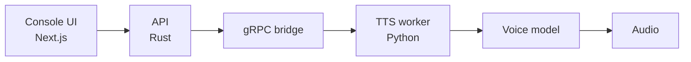

Miralas is our native Uzbek-speaking AI voice platform for streamers and content creators. It focuses on three things: **voice cloning**, **text-to-speech (TTS)** and **speech-to-speech (STS)**.

Here is where the project stands today.

## What exists

| Part | State |
| --- | --- |
| miralas.io landing site | Built, with docs and a public changelog |
| Console | Separate closed repo, running locally, not deployed yet |
| Authentication | Email sign-in and Google sign-in working end to end |
| Dashboard | Voices, generate and settings pages compiled and wired |
| Text-to-speech | Working end to end from the browser |

## How a sentence becomes audio

The Rust API handles auth, limits and routing. The Python worker handles the models. A gRPC bridge connects the two, so we can swap models without touching the rest of the system.

## Choosing the model

We tested several open-source models. Chatterbox Multilingual V2 produced Turkish with a heavy accent. Chatterbox Multilingual V3 fixed this, and Turkish pronunciation went from poor to very good. For English, Turkish and Russian, **Chatterbox V3 is now our production base**. You can read the full breakdown on the [models page](/models).

## The Uzbek problem

Uzbek is not among the 23 official languages of Chatterbox, and most other tools do not support it well either. That is exactly why Miralas exists. We are training our own Uzbek model, and training on rented GPUs started in October 2026. Alongside it we work with other open-source models, such as Llasa-3B.

<Callout type="warning">
  Uzbek quality depends on the voice recordings we collect. The model can only be as good as the
  voices it learns from.
</Callout>

## What comes next

1. Finish the Uzbek model and the first licensed voice profiles.
2. Open a free beta so early users can try it and give feedback.
3. Launch paid plans once the engine and voices are ready.
4. Build the voice agent on top of the Miralas core.